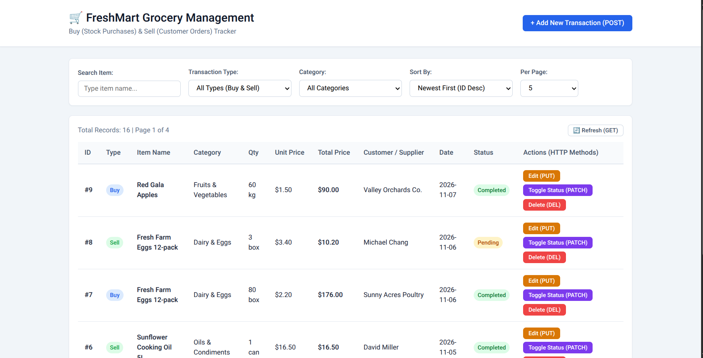

# Grocery Shop Sell & Buy Management System

A simple web application with a locally installed `json-server` backend and a pure HTML/CSS/JavaScript frontend.

---

## 📸 Application Preview



---

## 📁 Project Structure

```text
webteck/
├── db.json           # Grocery Buy & Sell database (JSON Server data source)
├── schema.json       # JSON Schema definition for transaction records
├── package.json      # NPM dependencies and run scripts
├── sample.png        # UI preview screenshot
├── public/           # Frontend static files served by JSON Server
│   ├── index.html    # Main frontend UI
│   ├── style.css     # Stylesheet
│   ├── app.js        # JavaScript application logic
│   └── sample.png
└── README.md
```

---

## 🚀 How to Run

### 1. Start JSON Server

Run either:
```bash
npm start
```
or
```bash
npm run server
```
or manually with npx:
```bash
npx json-server db.json -p 3000 -s ./public
```

The server will be available at:
- **Web App Frontend:** [http://localhost:3000](http://localhost:3000)
- **REST API Endpoint:** [http://localhost:3000/transactions](http://localhost:3000/transactions)

---

## 📊 Database Schema (`schema.json` & `db.json`)

Each transaction record represents a grocery stock purchase (**Buy**) or a customer sale (**Sell**):

| Field | Type | Description | Example |
|---|---|---|---|
| `id` | String | Unique record ID | `"1"` |
| `type` | String | Transaction type: `"Buy"` or `"Sell"` | `"Sell"` |
| `item` | String | Name of the grocery product | `"Basmati Rice 5kg"` |
| `category` | String | Product category | `"Grains & Staples"` |
| `quantity` | Number | Quantity bought or sold | `2` |
| `unit` | String | Unit of measure | `"bag"`, `"kg"`, `"bottle"` |
| `unitPrice` | Number | Price per unit | `14.50` |
| `totalPrice` | Number | Total price (`quantity * unitPrice`) | `29.00` |
| `party` | String | Customer (for Sell) or Supplier (for Buy) | `"Walk-in Customer"` |
| `date` | String | Date in YYYY-MM-DD | `"2026-11-03"` |
| `status` | String | `"Completed"`, `"Pending"`, or `"Cancelled"` | `"Completed"` |

---

## 🌐 HTTP Requests Demonstrated in Frontend (`app.js`)

All standard HTTP methods are implemented using standard `fetch`:

1. **GET (List with Pagination, Sorting & Filtering):**
   - Pagination: `GET /transactions?_page=1&_per_page=5`
   - Sorting: `GET /transactions?_sort=-id` or `_sort=-totalPrice`
   - Filtering: `GET /transactions?type=Sell&category=Dairy%20%26%20Eggs`
   - Search: `GET /transactions?item:contains=rice`

2. **POST (Create):**
   - Triggered by the **"+ Add New Transaction"** button and form.
   - Sends `POST /transactions` with JSON body to create a new record.

3. **PUT (Full Update):**
   - Triggered by the **"Edit (PUT)"** button.
   - Fetches the item, fills the modal form, and sends `PUT /transactions/:id` replacing all fields.

4. **PATCH (Partial Update):**
   - Triggered by the **"Toggle Status (PATCH)"** button.
   - Sends `PATCH /transactions/:id` with `{ "status": "..." }`, updating only the status property.

5. **DELETE (Remove):**
   - Triggered by the **"Delete (DEL)"** button.
   - Sends `DELETE /transactions/:id` after user confirmation.
